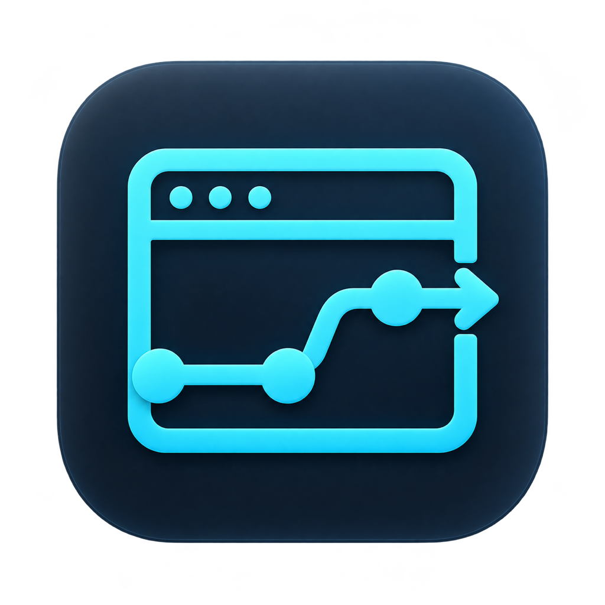
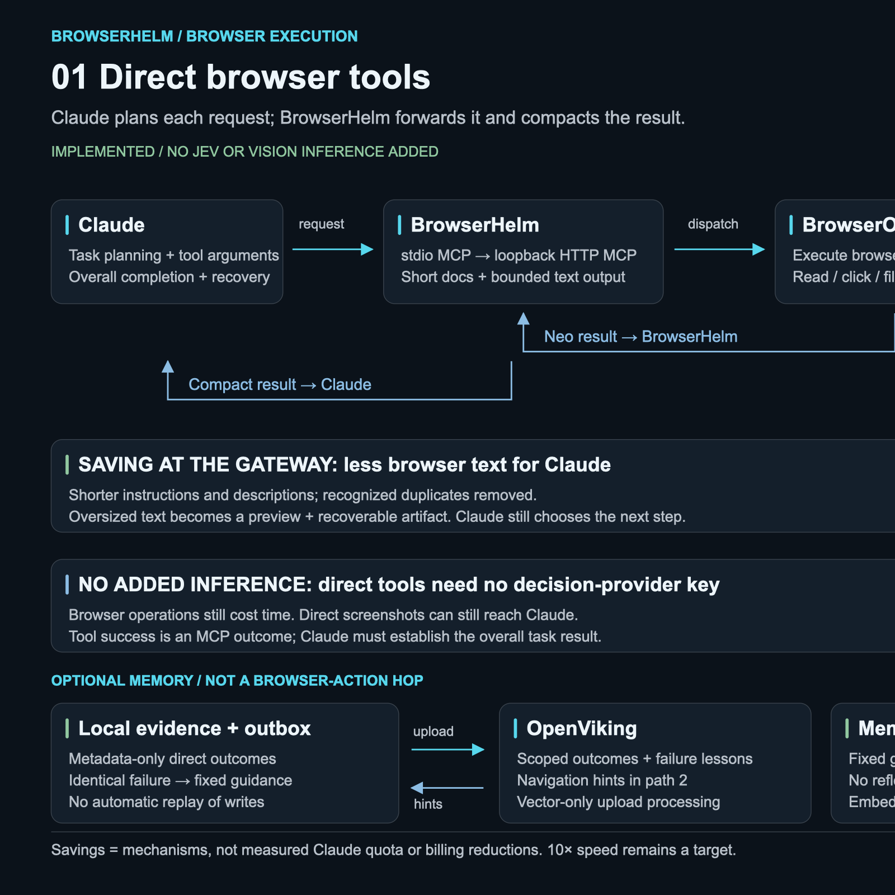
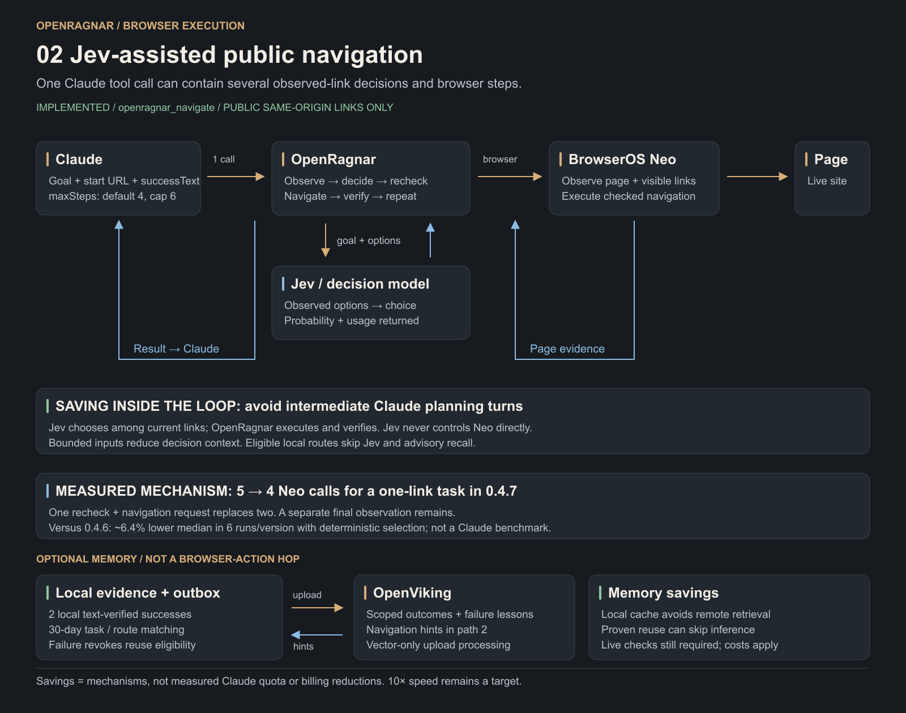
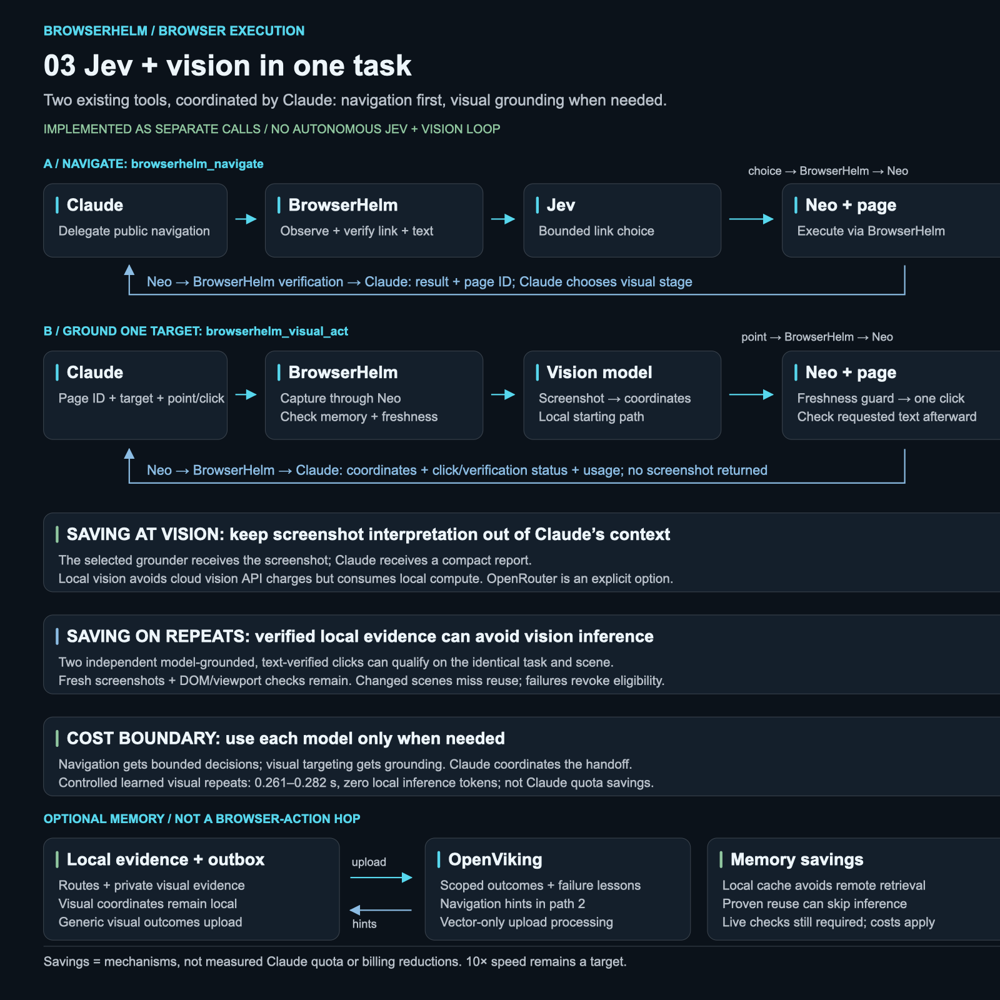
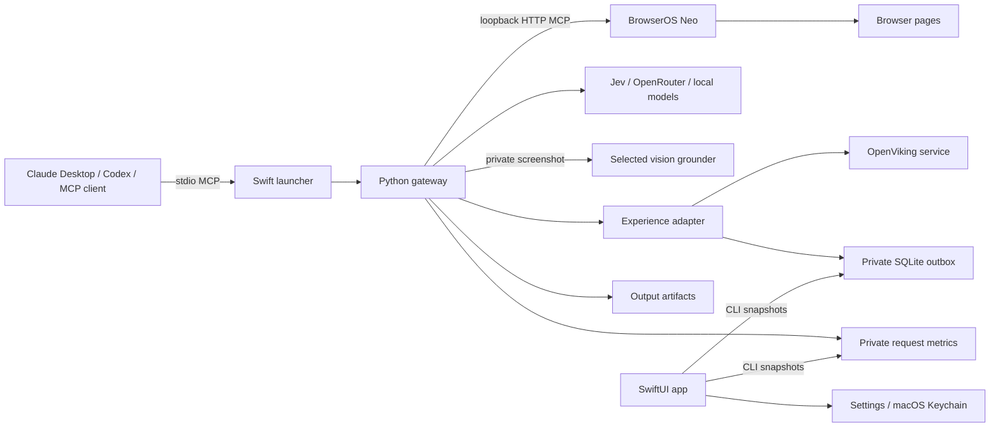

<p align="center">
  
</p>

<h1 align="center">BrowserHelm</h1>

<p align="center"><strong>A native macOS MCP gateway for browser agents.</strong><br>Compact browser context · Configurable models · Verified experience reuse</p>

<p align="center">
  <a href="https://github.com/RaDeleon/BrowserHelm/releases/latest"></a>
  <a href="https://github.com/RaDeleon/BrowserHelm/actions/workflows/ci.yml"></a>
  <a href="https://github.com/RaDeleon/BrowserHelm/releases"></a>
  <a href="LICENSE"></a>
  <a href="https://github.com/RaDeleon/BrowserHelm/stargazers"></a>
</p>

<p align="center">
  
  
  
  
</p>

<p align="center">
  <a href="https://github.com/RaDeleon/BrowserHelm/releases/latest"><strong>Download the latest release</strong></a> ·
  <a href="README-BrowserHelm.md">Setup guide</a> ·
  <a href="docs/benchmarks.md">Benchmarks</a> ·
  <a href="https://github.com/RaDeleon/BrowserHelm/releases">All releases</a>
</p>

### Built with

[](#source-map)

**Swift + SwiftUI / Swift Package Manager** for the native app, **Python** for the MCP engine, **SQLite** for local telemetry and experience evidence, and **shell + GitHub Actions** for building and distributing DMGs. BrowserOS Neo supplies external browser execution; OpenViking and model providers are optional integrations.

---

BrowserHelm connects an MCP client such as Claude Desktop or Codex to a separately running [BrowserOS Neo](https://github.com/browseros-ai/BrowserOS) instance. Neo executes browser actions. BrowserHelm controls how much browser context comes back and can delegate bounded navigation to Jev or another configured model.

The current **BrowserHelm 0.5.1** source and locally validated app target Apple Silicon Macs running macOS 14+. This is an experimental portfolio project. Preview DMGs are ad-hoc signed, not notarized. Neo is required and is not bundled.

New: [`browserhelm_execute`](docs/delegated-executor.md) accepts one bounded read-only browser plan, batches inspection/extraction, uses the configured decision provider for observed links and optionally locates visual targets. It returns explicit completion checks or partial progress with escalation. This reduces main-agent round trips for supported plans; general 10× speed and total-cost savings remain unproven.

**Settings → Browser execution → Delegate routine browser steps** lets you compare delegation with main-agent browser control while keeping compact forwarding. Save and reconnect after switching. See the [comparison procedure](docs/benchmarks.md#delegation-onoff-comparison); delegation remains optional pending matched quality, speed and total-cost evidence.

Download the current DMG from the [latest release](https://github.com/RaDeleon/BrowserHelm/releases/latest), or browse [all releases](https://github.com/RaDeleon/BrowserHelm/releases). This source version corresponds to **BrowserHelm 0.5.1** and the `BrowserHelm-0.5.1-arm64.dmg` asset. Older OpenRagnar previews remain available as historical builds. Release assets include a SHA-256 checksum, packaging verification report and source commit. Version tags trigger a tested Apple Silicon build and attach the DMG automatically. These previews are ad-hoc signed and not notarized; see the [setup guide](README-BrowserHelm.md) for macOS installation.

Latest results: the [0.4.12 optimization retest](#measured-results-0412) compares 18 tasks after fixes to task-marker overhead, executor arguments/help and oversized inspection. Task markers are now opt-in in Settings. The original [18-task pilot](docs/validation/2026-10-11-six-case-pilot.md) remains available for comparison.

## Requirements

BrowserHelm replaces OpenRagnar in version 0.5.0. See the [migration guide](docs/browserhelm-migration.md).

**BrowserHelm is macOS-only right now.** The current app and DMG support **Apple Silicon Macs running macOS 14 or later**. Windows, Linux and Intel Macs are not supported by the current release.

| To run the app | Requirement |
| --- | --- |
| Operating system | macOS 14 (Sonoma) or later. |
| Hardware | An Apple Silicon Mac (M-series chip). |
| Browser backend | BrowserOS Neo installed separately and running on the same Mac. It is not bundled with BrowserHelm. |
| AI client | Claude Desktop, Codex, or another MCP client that can launch a local stdio server. |
| Installation | Install `BrowserHelm.app` in `/Applications`, then configure and reconnect your MCP client. |

The packaged app includes its Python runtime. **You do not need to install Python or Xcode to run the DMG build.**

Additional services are optional and depend on which features you use:

| Feature | Additional requirement |
| --- | --- |
| Direct browser tools | No Jev or vision provider required. |
| Model-assisted navigation | A configured Jev or other supported decision provider, with an API key for providers that require one. |
| Local vision | Ollama or LM Studio running locally with a compatible vision model downloaded separately. |
| Cloud vision | Explicitly select OpenRouter and configure its API key; provider charges may apply. |
| Experience memory | A configured OpenViking service and private connection configuration. Embedding/storage costs may apply. |

**Building from source** additionally requires Xcode selected with `xcode-select` and a relocatable Apple Silicon Python 3.12 runtime for app packaging. See [Build and connect](#build-and-connect).

## Why build this?

Browser agents can repeatedly send large tool catalogs, page snapshots and duplicate results to the main model. BrowserHelm explores reducing that overhead while preserving access to complete browser output and making the execution path observable.

The engineering work includes MCP negotiation, context compaction and recovery, provider adapters, locally verified navigation, durable memory uploads, concurrent telemetry, macOS Keychain integration and app packaging. Payload reductions are measurable; Claude subscription savings still require matched task benchmarks.

## Performance target

**The target is 10× faster verified task completion than the same Claude/Codex client using BrowserOS Neo directly, without a proportional increase in cost.** The cost objective is equal or lower total cost per successful task. A 10× speedup at 10× the cost does not meet the product goal. This is a development target; current tests have not demonstrated that end-to-end advantage.

| Measure | Acceptance criterion |
| --- | --- |
| Speed | Baseline elapsed time divided by BrowserHelm elapsed time is at least 10 for the declared benchmark workload. Measure from task submission through independently verified completion. |
| Quality | Maintain or improve completion accuracy. Retain failures, recovery time and escalation; faster unsuccessful attempts are not completed tasks. |
| Cost | Compare total cost per successful task, including main-agent usage, decision and vision calls, and memory embedding/storage. Aim for equal or lower cost; disclose any increase separately from speed. Missing costs remain unknown. |
| Subscription efficiency | Track client-reported tokens and planner turns separately from API cost estimates. Lower usage can preserve allowance; it does not automatically lower a fixed subscription bill or establish a quota-savings percentage. |
| Learning | Report first-run and learned-repeat results separately, plus performance when the page changes. Improvement comes from verified procedure reuse and relevant failure lessons; model weights are not trained, and every new run is not guaranteed to improve. |

Use matched tasks, the same main-agent model and comparable browser state and tool exposure. Publish the task set, settings, sample size, success rate, median/tail latency and cost assumptions with any performance claim. Compare Neo directly with BrowserHelm local and cloud paths, with and without learning; follow the [benchmark procedure](docs/benchmarks.md). Small fixture timings, compacted bytes and individual calls avoided establish mechanisms, not the 10× target.

The development priority is fewer expensive planner round trips: bounded multi-step execution, deterministic browser evidence, verified experience reuse and compact results. Use Jev or vision when the task needs it, and justify cloud calls by measured total-task benefit. Local vision is the default starting path; users can explicitly select OpenRouter. Both paths must meet the same correctness and measurement requirements.

## Measured results (0.4.12)

These results were measured before the rename under OpenRagnar 0.4.12. BrowserHelm 0.5.0 preserves that engine behavior; the UI/name change is not a new performance measurement.

On **October 11, 2026**, the six-case suite ran **18 actual Claude tasks**, one attempt per case in each mode. All used **Opus 5.5 on High, Claude Code 2.1.296**, the same Neo backend and comparable task-specific tools. Delegated vision used local Ollama `qwen3-vl:2b-instruct`; the repeatable navigation plan used Jev. These are controlled Claude Code results, not persistent Claude Desktop timings.

| Mode | Independently verified | Sum of six task times | Main-agent turns | Main-agent API-equivalent cost |
| --- | ---: | ---: | ---: | ---: |
| BrowserOS Neo directly | 5/6* | 71.25s | 24 | $0.448888 |
| BrowserHelm, delegation off | 6/6 | 53.05s | 19 | $0.399326 |
| BrowserHelm, delegation on | 6/6 | 53.27s | 19 | $0.431377 |

| Task | Neo directly | Gateway off | Gateway on |
| --- | ---: | ---: | ---: |
| Guarded typography inspection | 6.34s | 5.08s | 5.32s |
| Public navigation and extraction | 20.28s* | 9.43s | 15.97s |
| Long-page constrained comparison | 8.63s | 9.62s | 6.83s |
| Canvas visual target | 9.14s | 11.67s | 9.64s |
| Unknown-outcome recovery | 9.37s | 8.37s | 7.36s |
| Repeatable navigation, first acquisition | 17.50s | 8.89s | 8.14s |

Compared with the original 0.4.11 pilot, delegation on went from **84.00s to 53.27s** across the six tasks (**37% less elapsed time**), from **35 to 19 planner turns**, and from **$0.567924 to $0.431377** in main-agent API-equivalent cost (**24% lower**). Both delegated passes verified 6/6 tasks. Optional markers removed 12 start/finish tool calls per gateway mode. The delegated public-navigation task had zero argument/help errors, down from four. Recovery deliberately injected one error per mode; all three runs verified exactly one submission.

Delegation off and on took nearly the same total time in this pass, with off using about **7% less main-agent API-equivalent spend**. Keep delegation optional and choose it for workloads where verified completion and total cost justify it. The open-ended navigation-on task used delegated reads and direct tools without a Jev decision; the repeatable-plan task invoked Jev once. These results do not measure a fully autonomous Jev browser loop.

*The direct-Neo navigation answer matched the expected URL, heading and explanation, but failed the independent live-state check. Stale tab URL metadata is a plausible verifier false negative. The attempt remains unverified and its time/cost remain in the totals; this is not evidence of a gateway accuracy advantage. The verifier was corrected and checked without another paid task.*

**Limits:** one sample per case/mode is not enough for reliable median/tail latency or broad performance claims. Totals sum different workloads and include failed verification, process/MCP startup, recovery and final independent checks; fixture preparation is outside the clock. Caching, run order and network variability remain confounds. The cost column is Claude's client-reported list-price API equivalent, not a Max subscription charge or measured allowance saving. Decision/vision fees and compute or memory costs are not fully priced, so total cost per successful task remains unknown. Cloud vision, remote OpenViking retrieval and learned repeats were not measured. **The 10× target has not been demonstrated.**

See the [full retest report](docs/validation/2026-10-11-six-case-retest-0.4.12.md), [original pilot](docs/validation/2026-10-11-six-case-pilot.md), [reproducible workload and settings](docs/six-case-benchmark.md), and [fix validation](docs/validation/0.4.12-pilot-fixes.md). Raw traces and usage are retained locally under ignored `dist/benchmarks/`; neither pilot was overwritten.

## Capabilities

| Capability | Behavior |
| --- | --- |
| Browser gateway | Preserves Neo read/write tools and `run`; 26 tools including gateway helpers, or 27 with vision enabled. |
| Vision | Select local Ollama/LM Studio or OpenRouter vision models for screenshot-to-point or single-click grounding, with freshness checks and compact reports. |
| Diagnostics | Searchable error records, HTTP/MCP codes, request correlation, app/connection identity, legacy Claude MCP log projection and local JSON report export. |
| Context control | Shortens documentation, removes recognized duplicates and bounds inline text with recoverable private artifacts. |
| Providers | TypeSafe AI / Jev, OpenRouter, Ollama, LM Studio and custom OpenAI-compatible endpoints. |
| Delegation | Selects observed same-origin public links, rechecks them and verifies a requested phrase locally. |
| Memory | Recalls OpenViking outcomes, reuses locally proven navigation routes and records direct-request failure/recovery lessons. |
| Desktop UI | Dashboard, Connectors, Sessions, Memory and Settings. |
| Telemetry | Request/session counters, provider usage, approximate moves and manually entered matched benchmarks. |

General read/write remains available through Neo's tools. The autonomous navigation loop excludes forms, buttons, query-string URLs and cross-origin navigation, and escalates on uncertainty, errors, cancellation or exhausted budgets. The separate visual tool can perform one explicitly requested click; it does not plan or loop.

## Architecture

### From Claude to the browser and back

Claude plans the task and chooses an MCP tool. **BrowserHelm is the execution gateway**, **Jev is a bounded text decision model**, **vision grounds a visual target**, and **BrowserOS Neo performs the browser actions**. Results return through BrowserHelm to Claude. Optional **OpenViking** stores and retrieves past outcomes; local evidence controls whether a proven route or visual target can skip inference.

The three workflow patterns below show where context or calls can be saved. **Jev and vision are separate tools today**: Claude can use both in a task, with a return to Claude between stages. BrowserHelm does not yet implement an autonomous combined Jev-plus-vision loop. Vision can also be used without Jev.

#### 1. Direct browser tools



Claude sends `run` or a granular browser tool; BrowserHelm forwards it to Neo and compacts the result. No Jev or vision inference is added. Shorter descriptions, duplicate removal and bounded text reduce browser context; omitted output remains recoverable. Claude retains planning and overall task verification.

#### 2. Jev-assisted public navigation



One `browserhelm_navigate` call can observe links, ask Jev to choose, recheck and follow the current link, and verify the requested phrase before returning to Claude. This can avoid intermediate Claude planning turns. Two qualifying local successes can permit route reuse without a decision call; live checks remain. The loop handles public same-origin links, not forms or arbitrary workflows.

#### 3. Jev and vision in the same task



Claude can navigate with Jev, then call `browserhelm_visual_act` for a target that structured page evidence cannot identify. BrowserHelm captures through Neo, asks the selected grounder for coordinates, checks freshness and optionally sends one explicit click. The visual tool returns a compact report without the screenshot. Local vision is the starting path; explicitly selected cloud vision adds provider cost. Qualifying identical-task/scene evidence can avoid inference on repeats.

**OpenViking is a memory side channel, not an action hop.** Navigation recall is local-first and bounded to two hints / 1.6 KB. Remote hints are advisory; only independent local verification can authorize automatic reuse. Outcomes and failure lessons queue for vector-only upload. Screenshot data and visual coordinates stay local. Memory embedding/storage costs can still apply.

**Savings labels describe mechanisms, not a measured Claude bill or quota reduction.** Historical smoke tests showed ~80% shorter instructions, ~40% smaller catalog bytes and ~98.5% smaller first snapshot output in an earlier configuration. The 0.4.7 navigation comparison removed one Neo call per followed link (5 → 4) and reduced median complete-call time ~6.4% on one deterministic task versus 0.4.6. These results do not demonstrate the 10× end-to-end target or a Neo-direct comparison.

Read the [complete execution walkthrough](docs/browser-execution.md) for exact dispatch, verification, memory, savings evidence and cost boundaries. Editable [direct](docs/images/browser-path-direct.svg), [Jev](docs/images/browser-path-jev.svg) and [Jev + vision](docs/images/browser-path-jev-vision.svg) SVGs accompany the PNGs.

### Runtime components



Each MCP connection launches its own gateway. Closing the GUI does not stop a client's gateway. Main-agent planning and recovery remain with the MCP client; the decision provider handles delegated choices.

## Build and connect

For a source build, use an Apple Silicon Mac running macOS 14+, Xcode selected with `xcode-select`, and a relocatable Apple Silicon Python **3.12** runtime for packaging. Keep BrowserOS Neo running for connection and live browser checks. Python unit tests also support 3.9+. For packaged-app requirements, see [Requirements](#requirements).

```sh
git clone https://github.com/RaDeleon/BrowserHelm.git
cd BrowserHelm
```

Download an `aarch64-apple-darwin` Python 3.12 `install_only` archive from the official [python-build-standalone releases](https://github.com/astral-sh/python-build-standalone/releases). Extract its `python` directory to `.runtime/python`, retaining its license notices. Alternatively set `BROWSERHELM_RUNTIME_SOURCE` to that directory. A system or Homebrew Python installation is not a substitute for the relocatable runtime.

```sh
./script/build_and_run.sh --build
./script/package_dmg.sh
python3 script/install_local.py
```

The first install command previews the migration. Finish active MCP/browser tasks, then install and open the app:

```sh
python3 script/install_local.py --apply --idle-confirmed
open /Applications/BrowserHelm.app
```

The package script creates a versioned `dist/BrowserHelm-<version>-arm64.dmg`. Install the app in Applications before configuring clients. **Connectors → Connect Claude Desktop** and **Connectors → Connect Codex** back up and add a separate `browserhelm` entry, preserving other servers. Codex setup uses its shared `~/.codex/config.toml` (or `CODEX_HOME/config.toml` when set), requires no separately installed CLI, preserves comments, and refuses invalid TOML or conflicting entries. Copy config remains available for manual setup. Open a new Codex chat or restart the client to load the tools. Configured is distinct from a live connection; old processes retain their loaded engine.

Local builds are ad-hoc signed. The [release guide](docs/releases.md) covers isolated test builds, Developer ID signing, notarization and the feature → staging → main workflow. Public signing remains unverified pending Apple Developer enrollment; setting up these scripts does not make an existing DMG notarized.

Other MCP clients can use:

```json
{
  "mcpServers": {
    "browserhelm": {
      "command": "/Applications/BrowserHelm.app/Contents/MacOS/BrowserHelm",
      "args": ["--mcp"]
    }
  }
}
```

Select a provider and save its endpoint, model and key in **Settings**. Keys use macOS Keychain and are fetched lazily; regular browser tools need no decision-provider key. **Test provider** makes a real provider request. Keychain may request approval after an ad-hoc rebuild.

See the [user guide](README-BrowserHelm.md) for provider endpoints, Codex configuration and setup details.

For optional screenshot grounding, open **Settings → Vision**. The tested starting model is `qwen3-vl:2b-instruct` in Ollama, downloaded separately (about 1.9 GB). Keep it local or select OpenRouter and one of three presets, then save. Enter your OpenRouter key in the vision section for cloud models. First enabling vision requires reconnecting your MCP client; subsequent model switches apply to its next request. Ask the client to use `browserhelm_visual_act` for visual targets instead of receiving screenshots itself. Jev remains your text decision provider. See [local vision setup, boundaries and tests](docs/local-vision.md). BrowserVLM's unreleased weights are not bundled, and this feature does not establish 10× speed or subscription savings.

## Try a delegated task

With Neo running and a provider configured, ask your MCP client:

> Use BrowserHelm's browserhelm_navigate. Start at https://docs.typesafe.ai/models, find the API reference describing choice-answer probabilities, and verify the phrase "floats that sum to 1". Use maxSteps 3. Report completion and the provider usage returned by the tool.

Success means the phrase was found in rendered page text, not that a broader goal is proven. Selected links must still exist on the current page. There are no automatic browser-action retries or paid-provider fallbacks.

## Dashboard appearance

BrowserHelm uses the Packet Studio design: graphite/navy surfaces, cyan accents, native sidebar navigation and a text-free browser/data-routing icon. New installations start in Dark appearance. Choose System, Light or Dark from the appearance menu or Settings. Context savings use a ring and comparison bars; the recent-request chart shows the latest 24 retained tool requests. Neo estimates, provider-reported tokens and manually entered Claude comparisons remain separate. Empty and unknown values are labeled instead of presented as measured zeroes.

The **Diagnostics** page adds searchable metadata-only events, failure explanations and next steps, connection/build identity, a fresh Neo connection check and local report export. New connections retain bounded events independently of token counters. Older failed counter rows and Claude MCP log codes remain visible with their limited detail clearly labeled. See the [diagnostics guide](README-BrowserHelm.md#diagnostics-and-debugging-041).

## Experience memory

Enable **Settings → OpenViking memory** to use an existing private `~/.openviking/ovcli.conf` connection. The Memory page shows uploaded/pending outcomes, recalled-hint counts and recent tasks.

- Retrieval is scoped to `viking://~/memories/experiences/browserhelm`, with at most two hints and a combined 1.6 KB hint budget per decision.
- Records contain user-provided goals and success phrases, public routes, provider/model and checked outcomes. Page bodies, screenshots, form contents and model reasoning are excluded. Common credential/email patterns are redacted; do not put confidential information in public-navigation goals.
- Offline uploads queue privately, use stable URIs and cross-process leases, and back off without retrying browser actions.
- Two local text-verified runs of the same navigation task can bypass a provider decision, while live link checks and text verification remain. Later route failures revoke eligibility. Remote hints remain advisory and cannot independently seed reuse.
- Direct requests retain metadata-only MCP outcomes and private HMAC fingerprints. Repeated identical failures return fixed guidance; failure/recovery lessons sync to OpenViking. This cannot infer the overall task goal or business completion, and never replays writes or trains model weights.
- The Memory page distinguishes recalled hints from provider calls avoided and reused tasks whose text was verified. Local cache hits avoid a remote retrieval call.

Uploads use vector-only processing. OpenViking embedding/storage costs may apply and are not included in the gateway's provider-token counter.

## Validation and measurement

The 0.4.0 source suite has **67 regression tests**. The local app passed MCP 2025-11-25 negotiation, the 26-tool catalog, writing/filling/readback on an owned public tab, complete omitted-output recovery, and read-only DMG relocation/signature checks. A live memory check saved a verified route and recalled it with an empty local cache; its selector was deterministic and made no model call.

The 0.4.1 suite adds diagnostics coverage for safe error classification, malformed/failed MCP responses, correlation, bounded retention, legacy log projection, missing counter storage and logging failures without action retries. A live constant-return call and controlled JavaScript exception verified that a real browser execution failure appears in Diagnostics and matches its request. The native UI connection check, failure filter, request link and local JSON export were exercised on this Mac.

The 0.4.2 suite has **101 gateway, diagnostics and learning tests**. A controlled live three-run navigation check required selector calls `[1, 1, 0]`: the third run reused a locally proven route and still made five browser calls with live link/text verification. A repeated real Neo error received prior-failure guidance. One explicitly tagged test outcome passed OpenViking upload/readback. This used a deterministic selector, not Jev, and establishes mechanism correctness rather than a model accuracy, speed or quota improvement. See [learning and performance](docs/learning-and-performance.md) for evidence and next-stage architecture.

After Keychain approval, an installed 0.4.0 Jev trial completed one public documentation task with one decision, five browser calls, 1,416 reported input tokens and 197 output tokens. It retrieved two experience hints, verified the requested phrase, and saved the outcome to OpenViking with confirmed readback. An earlier 0.2.1 trial reported 1,232 input tokens and 197 output tokens. These are separate smoke tests, not a matched savings or reliability benchmark. Other decision adapters have unit coverage; real OpenRouter/local decision servers were not exercised. The 0.4.4 Ollama vision adapter passed a controlled three-tile grounding trial and one text-verified click; a mismatched color description returned no point, so broad accuracy remains unproven.

The dashboard keeps text token equivalents (UTF-8 bytes divided by three), provider-reported usage, Neo's estimates and manually entered matched benchmarks distinct. Neo's aggregate statistics include gateway traffic and are not added to gateway savings. No Claude quota-savings percentage is claimed: hidden reasoning, full conversation replay, media billing, cache rates and subscription weighting are not observable here.

Run offline tests without browser accounts or paid model calls:

```sh
PYTHONDONTWRITEBYTECODE=1 python3 -m unittest discover -s neo-personal -p 'test_*.py'
PYTHONDONTWRITEBYTECODE=1 python3 -m unittest discover -s script -p 'test_*.py'
```

The 0.5.1 source suites have 206 engine tests and 26 release/settings/readiness tests, plus the benchmark oracle suite. Page-side JavaScript readiness tests use Node when available; the native settings probe runs on macOS. GitHub Actions runs both Python suites and a separate native Swift compile check. Live checks are opt-in; the [benchmark procedure](docs/benchmarks.md) explains their effects and how to measure matched tasks.

The 0.4.7 navigation pass removes one gateway-to-Neo round trip per followed link, defers key access and advisory recall until inference is needed, and waits for either the requested text or a usable link. A controlled linkless-page fixture avoids the former eight-second wait. See the [optimization review and measured limits](docs/validation/0.4.7-optimization-review.md).

## Source map

| Location | Responsibility |
| --- | --- |
| `mac-app/Sources/BrowserHelm/` | Native UI, launcher, settings and Keychain. |
| `neo-personal/gateway.py` | MCP transport, compaction and output recovery. |
| `neo-personal/browserhelm.py` | Delegation, verification, CLI and instrumentation. |
| `neo-personal/decision.py` | Provider adapters. |
| `neo-personal/vision.py` | Local/OpenRouter screenshot grounding and single-click freshness/verification guards. |
| `mac-app/Artwork/` | Original native app icon; editable Core Graphics source in `script/generate_icon.swift`. |
| `neo-personal/experience.py` | Retrieval, durable uploads and memory status. |
| `neo-personal/metrics.py` | Counters, connector discovery and Neo statistics. |
| `neo-personal/test_*.py` | Transport, privacy, concurrency and recovery regressions. |
| `script/` | Build, staging, packaging and relocation checks. |

The early installer remains only for rollback regression helpers; its direct CLI is disabled. Use the separate BrowserHelm entry rather than replacing official Neo entries.

## Repository contents and privacy

| Folder | Included in source downloads |
| --- | --- |
| `mac-app/` | Native app source and original icon assets. Swift build output is ignored. |
| `neo-personal/` | Gateway engine and regression tests. This legacy folder name is retained for existing build/import paths; the app is BrowserHelm. |
| `benchmarks/` | Reproducible harnesses, synthetic scenarios and independent test oracles. Raw run output is ignored. |
| `docs/` | Setup/release guides, diagrams and reviewed benchmark summaries. Historical results retain the name/version measured. |
| `script/` | Build, packaging, installation and validation tools. These are source files, not captured user sessions. |
| `.github/`, `.githooks/` | CI workflows and the opt-in local commit guard; no saved credentials. |

Generated reports, logs, captures, databases, private settings, local agent state, bundled runtimes, the separate BrowserOS checkout and design drafts stay outside Git. App packaging rejects local/test artifacts and includes only approved runtime resources. Required test source and sanitized results stay available for contributors. See [publication review](docs/publication.md) and [secret/artifact checks](docs/secret-checks.md).

## License and acknowledgments

Original BrowserHelm code is [Apache-2.0](LICENSE). Dependencies retain their own licenses; see [NOTICE](NOTICE) and [third-party notices](THIRD_PARTY_NOTICES.md).

[BrowserOS Neo](https://github.com/browseros-ai/BrowserOS) supplies external browser execution under its own AGPL-3.0 license. [OpenViking](https://github.com/volcengine/OpenViking) supplies external memory. Neither project is bundled in this source repository or app. Provider names identify compatibility and do not imply endorsement.

### Remove a client connection

In **Settings → MCP clients** or **Connectors**, choose **Remove from Claude Desktop** or **Remove from Codex** and confirm. Only BrowserHelm’s matching MCP entry is removed, with a private backup; other connectors and app data remain. Finish active browser work first. Restart the client to unload its cached tools. Use Connect to add the entry again.

## Repository activity

[](https://github.com/RaDeleon/BrowserHelm)

<sub>Release and CI badges use live repository metadata. GitHub Readme Stats cards are cached and may lag. Badge styling: <a href="https://shields.io/">Shields.io</a> and <a href="https://github.com/Ileriayo/markdown-badges">Markdown Badges</a>; technology icons: <a href="https://skillicons.dev/">Skill Icons</a>; repository card: <a href="https://github.com/anuraghazra/github-readme-stats">GitHub Readme Stats</a>.</sub>
