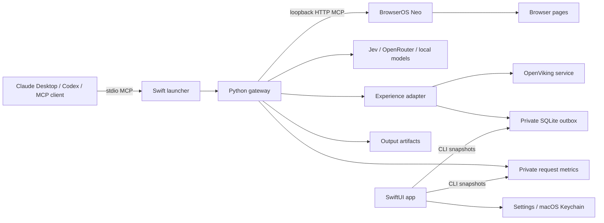

# OpenRagnar

**A native macOS MCP gateway for browser agents, with compact tool output, configurable decision providers, experience memory and usage telemetry.**

OpenRagnar connects an MCP client such as Claude Desktop or Codex to a separately running [BrowserOS Neo](https://github.com/browseros-ai/BrowserOS) instance. Neo executes browser actions. OpenRagnar controls how much browser context comes back and can delegate bounded navigation to Jev or another configured model.

Version **0.4.0** targets Apple Silicon Macs running macOS 14+. This is an experimental portfolio project. The local DMG is ad-hoc signed, not notarized. Neo is required and is not bundled.

## Why build this?

Browser agents can repeatedly send large tool catalogs, page snapshots and duplicate results to the main model. OpenRagnar explores reducing that overhead while preserving access to complete browser output and making the execution path observable.

The engineering work includes MCP negotiation, context compaction and recovery, provider adapters, locally verified navigation, durable memory uploads, concurrent telemetry, macOS Keychain integration and app packaging. Payload reductions are measurable; Claude subscription savings still require matched task benchmarks.

## Capabilities

| Capability | Behavior |
| --- | --- |
| Browser gateway | Preserves Neo read/write tools and `run`; the tested full catalog has 26 tools including gateway helpers. |
| Context control | Shortens documentation, removes recognized duplicates and bounds inline text with recoverable private artifacts. |
| Providers | TypeSafe AI / Jev, OpenRouter, Ollama, LM Studio and custom OpenAI-compatible endpoints. |
| Delegation | Selects observed same-origin public links, rechecks them and verifies a requested phrase locally. |
| Memory | Retrieves small OpenViking hints and saves verified or unverified delegated outcomes. |
| Desktop UI | Dashboard, Connectors, Sessions, Memory and Settings. |
| Telemetry | Request/session counters, provider usage, approximate moves and manually entered matched benchmarks. |

General read/write remains available through Neo's tools. The autonomous loop excludes forms, buttons, query-string URLs and cross-origin navigation, and escalates on uncertainty, errors, cancellation or exhausted budgets.

## Architecture



Each MCP connection launches its own gateway. Closing the GUI does not stop a client's gateway. Main-agent planning and recovery remain with the MCP client; the decision provider handles delegated choices.

## Build and connect

Requirements: an Apple Silicon Mac, macOS 14+, Xcode selected with `xcode-select`, running BrowserOS Neo, and a relocatable Apple Silicon Python **3.12** runtime for packaging. Python unit tests also support 3.9+.

```sh
git clone https://github.com/RaDeleon/OpenRagnar.git
cd OpenRagnar
```

Download an `aarch64-apple-darwin` Python 3.12 `install_only` archive from the official [python-build-standalone releases](https://github.com/astral-sh/python-build-standalone/releases). Extract its `python` directory to `.runtime/python`, retaining its license notices. Alternatively set `OPENRAGNAR_RUNTIME_SOURCE` to that directory. A system or Homebrew Python installation is not a substitute for the relocatable runtime.

```sh
./script/build_and_run.sh --build
./script/package_dmg.sh
open dist/OpenRagnar.app
```

This creates `dist/OpenRagnar-0.4.0-arm64.dmg`. Install the app in Applications before configuring clients. **Connectors → Connect Claude Desktop** backs up and merges a separate `openragnar` entry, preserving other servers. Reconnect the client after changes; old processes retain their loaded engine.

Other MCP clients can use:

```json
{
  "mcpServers": {
    "openragnar": {
      "command": "/Applications/OpenRagnar.app/Contents/MacOS/OpenRagnar",
      "args": ["--mcp"]
    }
  }
}
```

Select a provider and save its endpoint, model and key in **Settings**. Keys use macOS Keychain and are fetched lazily; regular browser tools need no decision-provider key. **Test provider** makes a real provider request. Keychain may request approval after an ad-hoc rebuild.

See the [user guide](README-OpenRagnar.md) for provider endpoints, Codex configuration and setup details.

## Try a delegated task

With Neo running and a provider configured, ask your MCP client:

> Use OpenRagnar's openragnar_navigate. Start at https://docs.typesafe.ai/models, find the API reference describing choice-answer probabilities, and verify the phrase "floats that sum to 1". Use maxSteps 3. Report completion and the provider usage returned by the tool.

Success means the phrase was found in rendered page text, not that a broader goal is proven. Selected links must still exist on the current page. There are no automatic browser-action retries or paid-provider fallbacks.

## Experience memory

Enable **Settings → OpenViking memory** to use an existing private `~/.openviking/ovcli.conf` connection. The Memory page shows uploaded/pending outcomes, recalled-hint counts and recent tasks.

- Retrieval is scoped to `viking://~/memories/experiences/openragnar`, with at most two hints and a combined 1.6 KB hint budget per decision.
- Records contain user-provided goals and success phrases, public routes, provider/model and checked outcomes. Page bodies, screenshots, form contents and model reasoning are excluded. Common credential/email patterns are redacted; do not put confidential information in public-navigation goals.
- Offline uploads queue privately, use stable URIs and cross-process leases, and back off without retrying browser actions.
- Hints are advisory evidence, not instructions, approval or model training. Direct Neo tool calls are not automatically learned because their overall goals and outcomes cannot be inferred safely.

Uploads use vector-only processing. OpenViking embedding/storage costs may apply and are not included in the gateway's provider-token counter.

## Validation and measurement

The 0.4.0 source suite has **67 regression tests**. The local app passed MCP 2025-11-25 negotiation, the 26-tool catalog, writing/filling/readback on an owned public tab, complete omitted-output recovery, and read-only DMG relocation/signature checks. A live memory check saved a verified route and recalled it with an empty local cache; its selector was deterministic and made no model call.

An earlier 0.2.1 Jev trial completed one public task with one decision, 1,232 reported input tokens and 197 output tokens. This is historical smoke-test evidence, not a reliability benchmark. The rebuilt 0.4.0 live Jev trial required renewed Keychain approval. Other adapters have unit coverage; real OpenRouter/local-model servers were not exercised.

The dashboard keeps text token equivalents (UTF-8 bytes divided by three), provider-reported usage, Neo's estimates and manually entered matched benchmarks distinct. Neo's aggregate statistics include gateway traffic and are not added to gateway savings. No Claude quota-savings percentage is claimed: hidden reasoning, full conversation replay, media billing, cache rates and subscription weighting are not observable here.

Run offline tests without browser accounts or paid model calls:

```sh
PYTHONDONTWRITEBYTECODE=1 python3 -m unittest discover -s neo-personal -p 'test_*.py'
```

GitHub Actions runs the Python suite and a separate native Swift compile check. Live checks are opt-in; the [benchmark procedure](docs/benchmarks.md) explains their effects and how to measure matched tasks.

## Source map

| Location | Responsibility |
| --- | --- |
| `mac-app/Sources/OpenRagnar/` | Native UI, launcher, settings and Keychain. |
| `neo-personal/gateway.py` | MCP transport, compaction and output recovery. |
| `neo-personal/openragnar.py` | Delegation, verification, CLI and instrumentation. |
| `neo-personal/decision.py` | Provider adapters. |
| `neo-personal/experience.py` | Retrieval, durable uploads and memory status. |
| `neo-personal/metrics.py` | Counters, connector discovery and Neo statistics. |
| `neo-personal/test_*.py` | Transport, privacy, concurrency and recovery regressions. |
| `script/` | Build, staging, packaging and relocation checks. |

The early installer remains only for rollback regression helpers; its direct CLI is disabled. Use the separate OpenRagnar entry rather than replacing official Neo entries.

## License and acknowledgments

Original OpenRagnar code is [Apache-2.0](LICENSE). Dependencies retain their own licenses; see [NOTICE](NOTICE) and [third-party notices](THIRD_PARTY_NOTICES.md).

[BrowserOS Neo](https://github.com/browseros-ai/BrowserOS) supplies external browser execution under its own AGPL-3.0 license. [OpenViking](https://github.com/volcengine/OpenViking) supplies external memory. Neither project is bundled in this source repository or app. Provider names identify compatibility and do not imply endorsement.
