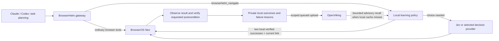

# Learning and performance: 0.4.2

The target is fewer expensive planner turns and smaller context at equal task correctness. **10× faster tasks or 10× lower Claude quota consumption have not been demonstrated.** A smaller payload, a skipped provider call and an end-to-end quota reduction are different measurements.

## Current execution paths

Jev already **is a model**. BrowserHelm uses it for bounded text choices, not arbitrary browser planning or screenshot grounding. Since 0.4.4, the optional `browserhelm_visual_act` tool handles screenshot grounding through a separate local vision model. Ordinary `run`, `act`, `evaluate`, etc. continue to be planned by the main agent. BrowserOS Neo executes the actual browser operations. OpenViking is persistent context and retrieval, not a browser controller or a replacement for the planner.

## What changed

| Mechanism | Evidence required | Effect | Limit |
| --- | --- | --- | --- |
| Verified route reuse | Two separate local text-verified navigation runs matching start, goal and success phrase within 30 days | Bypasses one decision-provider call per reused link | Live observed link check and postcondition check still required; no forms/buttons |
| Failure invalidation | A later unverified route or attempted link | Removes reuse eligibility until two new successes | Does not permanently blacklist the site or invent another action |
| Navigation lessons | Fixed failure category, attempted/visited links | Adds bounded guidance to later provider choices, including failures before any completed hop | Advice can be unhelpful; benchmark task completion rather than recall counts |
| Direct-request history | MCP status/category and a local keyed fingerprint of exact tool arguments | A repeated identical failure returns guidance to the main agent | A successful MCP request does not prove overall task completion |
| Local-first recall | Relevant valid cached outcome | Avoids a memory-service round trip | OpenViking still supplies advisory recall on a miss; remote hints alone never seed automatic reuse |
| Service cooldown | Failed retrieval at the same configured destination | Avoids repeated memory lookup delays for 30 seconds | Browser forwarding remains independent of memory availability |

No extra reflection-model calls, online weight training or automatic replay of writes were added. Each direct request contributes bounded local metadata when memory is enabled; only reusable failure/recovery lessons queue for OpenViking. Full task learning for arbitrary read/write flows requires the main agent to supply a task boundary, intended postcondition and verification evidence. The gateway cannot extract those reliably from anonymous JavaScript calls.

## Evidence

Historical public-page payload smoke tests recorded instruction characters 7,322 → 1,474, catalog bytes 47,582 → 28,707 and one full snapshot response 134,750 → 1,976 bytes, with omitted output recoverable. That snapshot comparison used a bounded first response; fetching every omitted chunk spends context again. These were an earlier configuration/Neo build, not quota measurements for the current full catalog.

A prior live Jev documentation task reported a 0.163 s provider decision, five browser calls, 2.328 s task time, 1,416 input tokens and 197 output tokens. It recalled hints and verified the requested phrase. This single task does not prove that memory improved the choice. It also illustrates why stacking another decision model after Jev may optimize the wrong bottleneck.

The 0.4.2 controlled live test made three identical public documentation tasks in a temporary cache:

| Run | Deterministic selector calls | Browser calls | Requested text verified | Elapsed seconds |
| --- | ---: | ---: | --- | ---: |
| First | 1 | 5 | Yes | 0.836 |
| Second | 1 | 5 | Yes | 0.865 |
| Third, learned route | 0 | 5 | Yes | 0.806 |

The selector was deterministic and made **no Jev/LLM call**. These timings show mechanism correctness, not a model latency improvement or a 10× result. The same test verified prior-failure guidance on a real repeated Neo error and one explicitly tagged OpenViking test outcome's upload/readback. Test records cannot seed production hints or reuse. Regression tests cover stale links, changed intent, redaction collisions, competing routes, failure invalidation, expiry, disabled/offline memory, private request fingerprints and preserving browser behavior when memory fails.

## Where a local model could help

Use deterministic code and current DOM/accessibility references when they identify the target. Use the selected decision provider when the bounded intent is ambiguous. The 0.4.4 optional local vision branch handles **screenshot-to-control grounding when structured browser evidence is inadequate**. It is a separate capability, not a mandatory second reasoning pass after Jev. [Local vision](local-vision.md) documents setup and boundaries.

Jev's current documentation specifies text-only input and no per-account fine-tuning. BrowserOS's BrowserVLM announcement describes a small vision model for precise click grounding, with CPU/Apple Silicon deployment planned; its announcement still labels weights/code as coming soon. This is distinct from Jev's text-choice role. These public sources do not establish the exact $19/$20 "10×" offer described by the user.

Primary sources checked October 10, 2026: [BrowserOS Neo](https://browseros.com/), [BrowserVLM](https://www.browseros.com/blog/browservlm/), [TypeSafe models and customization](https://docs.typesafe.ai/models).

A local model may save screenshot tokens and network latency if it replaces an expensive planner step. Model loading, inference, memory pressure and extra recovery can make it slower if added as another mandatory call. Ollama/LM Studio are already alternative decision-provider adapters; their real performance on this Mac has not been benchmarked. Do not bundle weights or promise a speed increase before a matched test.

The local vision branch has a controlled canvas fixture check with Qwen3-VL 2B Instruct and Ollama on this Mac. Retina-aware capture reduced the same fixture's model prompt count from 4,034 to 1,180, with 27 output tokens in each case. The first smaller-frame point inference took 0.678 s after model loading; repeating it for a click took 0.139 s with caching. End-to-end calls took 0.762 s and 0.295 s and returned 553/559 bytes with no image. The larger-frame cold/model-switch run took 18.699 s. These are narrow capability measurements, not main-agent quota savings or typical task latency. The non-Instruct model exhausted an 80-token output budget in reasoning and returned no point; that failed run sent no click. The default is therefore the explicit Instruct model with bounded output.

## Next acceptance gates

1. Define a set of repeatable tasks with independently checked postconditions, covering public navigation and representative authorized read/write work.
2. Compare main-agent browser use, Neo directly, BrowserHelm without memory, and BrowserHelm with learning from equivalent initial conditions. Use fresh chats and equivalent tool exposure; retain failed runs.
3. Measure task correctness, main-agent turns, median/tail task latency, client-reported total usage and provider-reported decision usage. Report memory costs separately; the MCP gateway cannot read Claude subscription weighting or hidden reasoning totals.
4. Expand delegation beyond public links with explicit task boundaries and postconditions, constrained observed actions, and escalation. Generic forwarded calls must not be counted as delegated execution.
5. Trial a specialist local grounder only on tasks needing vision; keep it only if it reduces total latency/usage at equivalent correctness.

These gates make an improvement claim reviewable. There is no guarantee that every run improves: websites change, memory can become stale, and an uncertain situation should escalate rather than reinforce an incorrect lesson.
